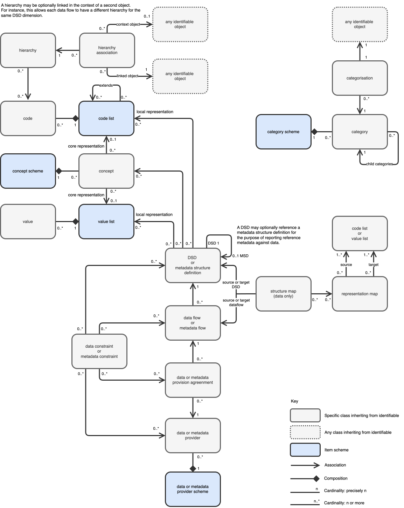

# The Standard for Data and Metadata

Welcome to the official technical documentation for **SDMx** - the **S**tandard
for **D**ata and **M**etadata

SDMx provides an internationally agreed framework for modelling, exchanging and
sharing data and metadata across organisations and systems.

This site brings together the SDMx technical specifications in a single,
searchable and easy-to-navigate resource. It provides the information needed to
understand the standard, develop SDMx-compatible software and implement
interoperable data and metadata services.

The documentation is maintained by the SDMx Technical Working Group (TWG).

## SDMx 3.2 Core Information Model

The SDMx Core Information Model defines the fundamental building blocks for
describing, structuring and exchanging data and metadata. The version of SDMx
corresponds to the version of its Information Model, while the REST API and
transmission formats are versioned independently.

The diagram below provides a high-level overview of the SDMx 3.2 Information
Model, illustrating its principal components and relationships. It is intended
as an introduction rather than a comprehensive representation of the model.

## Explore the Specifications

The SDMx technical specifications are organised into several complementary
parts, covering the Information Model, APIs, transmission formats and
implementation guidance. Explore the sections below to learn more about each
component of the standard.

### Framework and Information Model

Understand the foundations of SDMx and how data, metadata and their
relationships are modelled.

- **Framework** — An introduction to the SDMx technical standards, their scope
  and underlying principles.
- **Information Model** — The core objects, structures and relationships used to
  describe, organise and exchange data and metadata.

### Registries and Technical Guidance

Explore how SDMx metadata is managed, discovered, shared and reused.

- **Registry Specification and Logical Interfaces** — Architecture and
  interfaces for managing and sharing SDMx structural metadata.
- **Technical Notes** — Additional guidance and recommendations for implementing
  the standard.

### REST API

Learn how to access and exchange SDMx data and metadata through standardised web
services.

- **REST API** — Specifications for querying, retrieving and maintaining SDMx
  resources, including data, metadata, structures and schemas.

### Transmission Formats

Explore the standard formats for exchanging SDMx data and metadata between
systems.

- **SDMx-ML** — XML-based formats for exchanging data, metadata and structures.
- **SDMx-JSON** — JSON-based formats for exchanging data, metadata and
  structures.
- **SDMx-CSV** — CSV-based formats for exchanging data and reference metadata.

## Specification Versions

The SDMx version number corresponds to the version of the Information Model. The
REST API and transmission formats (SDMx-ML, SDMx-JSON and SDMx-CSV) are
versioned independently and may evolve separately from the Information Model.
The table below shows the versions of each specification associated with each
SDMx release.

| SDMx | REST API | SDMx-ML | SDMx-JSON | SDMx-CSV |
| ---- | -------- | ------- | --------- | -------- |
| 3.1  | 2.2      | 3.1     | 2.1       | 2.1      |
| 3.0  | 2.0      | 3.0     | 2.0       | 2.0      |
| 2.1  | 1.5      | 2.1     | 1.0       | 1.0      |

Earlier versions and additional release information are available through the
individual specification repositories.

## Feedback and Contributions

The SDMx technical specifications are maintained by the SDMx Technical Working
Group (TWG).

We welcome feedback from the community, including reports of errors, requests
for clarification and proposals for improvement.

Each part of the standard has a dedicated GitHub repository where issues can be
raised and discussed.

| Specification          | GitHub Issues                                                                          |
| ---------------------- | -------------------------------------------------------------------------------------- |
| Information Model      | [View issues](https://github.com/sdmx-twg/sdmx-im/issues?utm_source=chatgpt.com)       |
| REST API               | [View issues](https://github.com/sdmx-twg/sdmx-rest/issues?utm_source=chatgpt.com)     |
| SDMx-ML (XML)          | [View issues](https://github.com/sdmx-twg/sdmx-ml/issues?utm_source=chatgpt.com)       |
| SDMx-JSON              | [View issues](https://github.com/sdmx-twg/sdmx-json/issues?utm_source=chatgpt.com)     |
| SDMx-CSV               | [View issues](https://github.com/sdmx-twg/sdmx-csv/issues?utm_source=chatgpt.com)      |
| Registry Specification | [View issues](https://github.com/sdmx-twg/sdmx-registry/issues?utm_source=chatgpt.com) |
